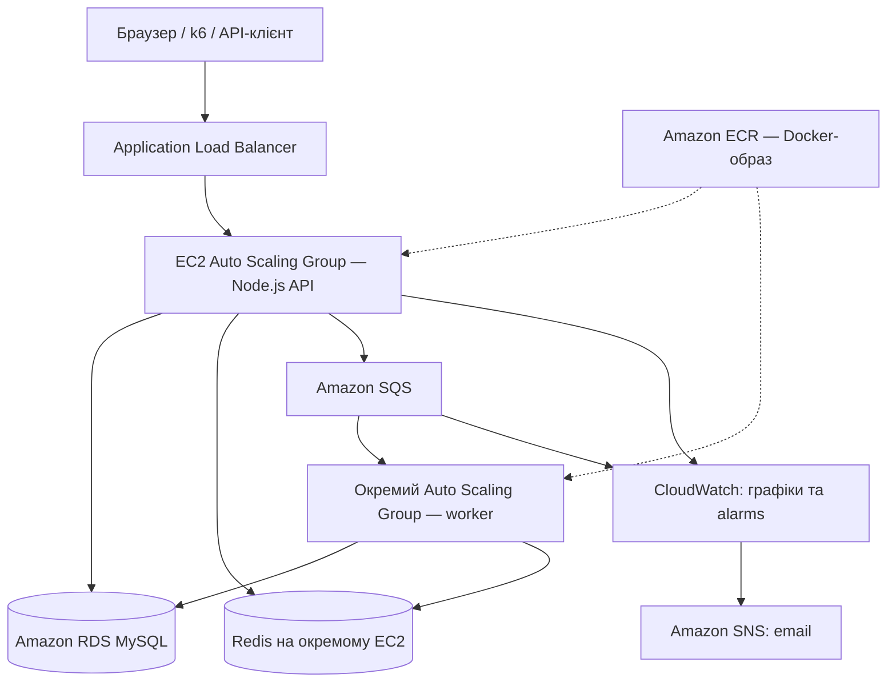
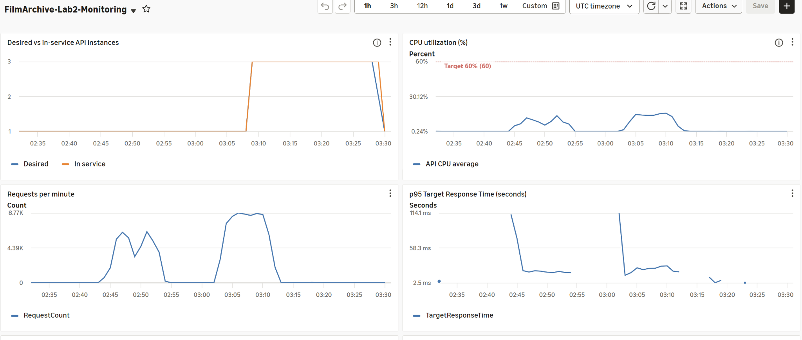

# FilmArchive

**REST API та вебзастосунок для персональної колекції фільмів, серіалів, аніме й іншого медіаконтенту.** Проєкт розвиває архітектуру лабораторної роботи №1 і реалізує завдання лабораторної роботи №2: горизонтальне масштабування, навантажувальне тестування, моніторинг, сповіщення, кешування та додаткові механізми надійної обробки запитів.

Усе зібрано в [основному репозиторії FilmArchive](https://github.com/uliana-dol/film-archive). Інфраструктура описується Terraform, застосунок запускається в Docker, а результати експериментів документуються українською.

## Можливості

- JWT-авторизація: реєстрація та вхід користувачів.
- Персональна медіатека: додавання, перегляд, редагування та видалення записів.
- Метадані з OMDb API, якщо задано відповідний ключ; можливість зберігати власні записи.
- Cache-aside для списку медіа: Redis, TTL **45 секунд**, інвалідація після зміни даних.
- Захист повторних записів за заголовком `Idempotency-Key` із TTL **24 години**.
- Асинхронний інтерфейс `202 Accepted` із перевіркою статусу завдання через API; черга Redis локально та Amazon SQS у хмарі.
- Горизонтальне масштабування REST API за навантаженням, графіки CloudWatch і листи SNS.
- Денні й нічні правила кількості EC2 для контролю витрат.

## Архітектура



На локальному комп'ютері API, MySQL, Redis і worker запускаються через Docker Compose. У хмарі ALB розподіляє запити між контейнерами API на EC2, RDS зберігає дані, Redis прискорює читання, а SQS забезпечує асинхронну передачу завдань обробнику.

## Технології

| Компонент | Технологія |
|---|---|
| API | Node.js 22, Express, JWT |
| Інтерфейс | HTML, CSS, JavaScript |
| База даних | MySQL (локально MySQL 8, у AWS RDS MySQL 8.4) |
| Кеш / ідемпотентність | Redis 7 |
| Контейнери | Docker, Docker Compose |
| Хмарні сервіси | AWS EC2, Auto Scaling, ALB, RDS, ECR, SQS, CloudWatch, SNS, SSM, IAM |
| Infrastructure as Code | Terraform |
| CI/CD | GitHub Actions, AWS OIDC |
| Навантаження | Grafana k6 |

## Запуск локально

Потрібні Docker Desktop / Docker Compose та PowerShell. Команди виконуються з кореня репозиторію.

```powershell
Copy-Item .env.example .env
code .env
```

У `.env` потрібно встановити власні значення `DB_PASSWORD`, `MYSQL_ROOT_PASSWORD`, `JWT_SECRET`. За необхідності додати `OMDB_API_KEY`. **Не публікувати `.env`.**

```powershell
docker compose -p film_archive_lab2 up --build -d
docker compose -p film_archive_lab2 exec api npm run migrate
docker compose -p film_archive_lab2 ps
```

У перевіреній конфігурації лабораторної №2 зовнішній порт API — **3001** (порт усередині контейнера — 3000):

- Вебінтерфейс: <http://localhost:3001/>
- Swagger: <http://localhost:3001/api-docs/>
- Health check: <http://localhost:3001/api/health>

Якщо в локальному `compose.yaml` використано інший порт, потрібно підставити його у відповідні URL.

Зупинити контейнери без видалення даних:

```powershell
docker compose -p film_archive_lab2 down
```

## Основні маршрути API

| Метод | Маршрут | Призначення |
|---|---|---|
| `POST` | `/api/auth/register` | Реєстрація |
| `POST` | `/api/auth/login` | Вхід, отримання JWT |
| `GET` | `/api/media` | Список медіа користувача |
| `GET` | `/api/media/:id` | Один запис |
| `GET` | `/api/media/me` | Профіль користувача |
| `POST` | `/api/media` | Створення запису; підтримує `Idempotency-Key` |
| `PUT` | `/api/media/:id` | Оновлення запису |
| `DELETE` | `/api/media/:id` | Видалення запису |
| `GET` | `/api/media/cache-stats` | Лічильники кешу та hit ratio |
| `POST` | `/api/media/async` | Постановка асинхронного завдання, `202 Accepted` |
| `GET` | `/api/media/jobs/:jobId` | Перегляд стану завдання |
| `GET` | `/health` | Перевірка для ALB |
| `GET` | `/api/health` | JSON health check |

Захищені маршрути `/api/media` використовують заголовок `Authorization: Bearer <JWT>`.

## Перевірки та навантажувальні експерименти

Локальні перевірки:

```powershell
docker compose -p film_archive_lab2 exec api npm test
powershell -ExecutionPolicy Bypass -File .\scripts\smoke.ps1 -BaseUrl http://localhost:3001
```

**Перевірені результати:** 7 із 7 автоматизованих тестів успішні; локальний smoke-тест пройшов усі 5 етапів. В AWS підтверджено авторизацію, профіль, ідемпотентність і Redis. Для асинхронного запису передбачено окремий маршрут та [технічний звіт QUEUE.md](docs/QUEUE.md).

Навантажувальний сценарій у [`loadtest/filmarchive.js`](loadtest/filmarchive.js) за одну ітерацію виконує **один POST і дев'ять GET-запитів**. Тривалість — **10 хвилин:** 3 хв наростання, 5 хв стабільного навантаження та 2 хв спаду.

```powershell
k6 run `
  -e BASE_URL=http://localhost:3001 `
  -e VUS=10 `
  -e RUN_ID=local01 `
  --summary-export=loadtest/results-local01.json `
  .\loadtest\filmarchive.js
```

### Результати експериментів 19–20.11.2026

| Середовище / сценарій | HTTP-запитів | Запитів/с | p50 | p95 | p99 |
|---|---:|---:|---:|---:|---:|
| Локально, Redis увімкнений (`local01`) | 128 000 | 213,29 | 11,97 мс | 62,99 мс | 102 мс |
| Локально, Redis вимкнений (`nocache01`) | 149 920 | 249,84 | 10,17 мс | 40,35 мс | 61,54 мс |
| AWS, перший k6 (`aws-lab2-final`) | 43 550 | 72,44 | 200,96 мс | 841,40 мс | 1,45 с |

Локальні прогони проведено послідовно в різних станах бази даних, тому їх не можна інтерпретувати як ізольований експеримент, що доводить перевагу одного режиму. Докладні результати другого хмарного прогону `aws-scale02` заповнені з локального JSON в [`docs/LOADTEST.md`](docs/LOADTEST.md).

## AWS Auto Scaling і моніторинг

Інфраструктура FilmArchive створена Terraform у `eu-north-1` та перевірена в AWS. Група API налаштована на **мінімум 1, максимум 3 EC2**. Для керування кількістю використовуються:

- CPU policy — ціль **60%** середнього використання процесора, підтримує збільшення та зменшення кількості EC2.
- Requests policy — ціль **1 000 запитів на хвилину на екземпляр** (`ALBRequestCountPerTarget`), використовується для scale-out; її власний scale-in вимкнений.
- Період прогрівання нового інстанса — **180 секунд**.

**Зафіксований результат другого AWS-тесту:** автоматичне масштабування API **1 → 3 → 1 EC2**. Основним тригером у цьому експерименті була кількість запитів, а не перевищення 60% CPU.

CloudWatch Dashboard `FilmArchive-Lab2-Monitoring` містить п'ять обов'язкових графіків: бажана/фактична кількість серверів, CPU, запити за хвилину, p95, 5xx. Окремий графік показує чергу SQS і кількість worker. Для метрики 5xx в обраному інтервалі AWS не повертав точок, що відображено на графіку як `No data available`.



Деталі: [AUTOSCALING.md](docs/AUTOSCALING.md) та [LOADTEST.md](docs/LOADTEST.md).

## Сповіщення CloudWatch і SNS

Створено правило `filmarchive-app-max-replicas`: якщо **три API-екземпляри працюють протягом двох хвилин**, CloudWatch переходить у стан `ALARM`; після зменшення кількості серверів повертається до `OK`. Повідомлення надходять через підтверджену SNS-підписку.

Зафіксовані переходи **20.11.2026**:

| Стан | Час UTC | Час Київ (UTC+2) |
|---|---|---|
| `OK → ALARM` | 03:11:32 | 05:11:32 |
| `ALARM → OK` | 03:31:32 | 05:31:32 |

Тривалість стану тривоги — **20 хвилин**. Обидва листи зафіксовано у [ALERTS.md](docs/ALERTS.md) разом зі скриншотами та аналізом затримок.

## Кеш, черга, ідемпотентність і розклад

- **Redis cache-aside:** читання списку з кешу; TTL 45 с; інвалідація при записі; статистика hit/miss. [CACHE.md](docs/CACHE.md)
- **Асинхронна обробка:** `202 Accepted`, SQS Standard і worker EC2, масштабування worker від появи повідомлень у черзі. [QUEUE.md](docs/QUEUE.md)
- **Ідемпотентність:** `Idempotency-Key`, повторний запит повертає раніше збережений результат; TTL у Redis 86 400 с. Реальним тестом підтверджено один запис для повторних запитів. [IDEMPOTENCY.md](docs/IDEMPOTENCY.md)
- **Масштабування за розкладом:** **06:00 UTC** — мінімум 2, **20:00 UTC** — мінімум 1; це відповідає 08:00/22:00 за Києвом у зимовий час. [SCHEDULE.md](docs/SCHEDULE.md)

## Структура проєкту

```text
film_archive/
├── .github/workflows/deploy.yml  
├── docs/
│   ├── AUTOSCALING.md
│   ├── LOADTEST.md
│   ├── ALERTS.md
│   ├── CACHE.md
│   ├── QUEUE.md
│   ├── IDEMPOTENCY.md
│   ├── SCHEDULE.md
│   └── screenshots/
├── loadtest/
│   ├── filmarchive.js
│   ├── queue.js
│   └── README.md
├── scripts/
│   ├── smoke.ps1
│   └── aws-readonly-check.ps1
├── src/
│   ├── controllers/
│   ├── routes/
│   ├── lib/
│   ├── bootstrap-db.js
│   ├── migrate.js
│   ├── server.js
│   └── worker.js
├── terraform/
│   ├── main.tf
│   ├── variables.tf
│   ├── autoscaling.tf
│   ├── request-scaling.tf
│   ├── monitoring.tf
│   ├── oidc.tf
│   └── templates/
├── tests/
├── public/
├── compose.yaml
├── compose.aws.yaml
├── Dockerfile
├── init.sql
└── README.md
```

## Безпека та робота з AWS

- AWS використовує IAM-ролі, SSM Parameter Store (`SecureString`) та GitHub Actions OIDC; секрети не записуються в коміти.
- Не додавати до Git: `.env`, будь-які приватні `.tfvars`, `terraform.tfstate`, плани Terraform, облікові дані AWS чи тимчасові Docker-токени.
- Terraform state для практичного AWS-розгортання зберігається в **окремому робочому каталозі**, щоб не змішувати його зі станом лабораторної №1. Основні `.tf`-файли містяться в репозиторії.
- `terraform apply` створює ресурси, що можуть споживати AWS-кредити: EC2, RDS, ALB та інші. Після демонстрації та збереження доказів ресурси прибирають із **правильного** Terraform workspace, перевіривши наслідки видалення бази даних.

## Документація лабораторної №2

| Завдання лабораторної №2 | Звіт |
|---|---|
| 1. Автоматичне масштабування | [docs/AUTOSCALING.md](docs/AUTOSCALING.md) |
| 2. Навантажувальне тестування | [docs/LOADTEST.md](docs/LOADTEST.md) |
| 3. Панель моніторингу | [docs/AUTOSCALING.md](docs/AUTOSCALING.md) |
| 4. Сповіщення | [docs/ALERTS.md](docs/ALERTS.md) |
| 5. Кешування | [docs/CACHE.md](docs/CACHE.md) |
| 6. Черга й worker (бонус) | [docs/QUEUE.md](docs/QUEUE.md) |
| 7. Ідемпотентність (бонус) | [docs/IDEMPOTENCY.md](docs/IDEMPOTENCY.md) |
| 8. Масштабування за розкладом (бонус) | [docs/SCHEDULE.md](docs/SCHEDULE.md) |


## Результати фінальної перевірки AWS (20.11.2026)

- Навантажувальний тест Grafana k6: **48 580 HTTP-запитів за 10 хв, 0% помилок, p95 = 636,84 мс, 30 VU**.
- Автоматичне масштабування API з **1 до 3 EC2**, подальше зменшення; окремий контрольований CPU-стрес-тест підтвердив перетин порогу **60%** і пік **100% CPU**.
- Реальні SNS-сповіщення `ALARM` та `OK` від **07:10:32** і **07:23:32** за Києвом відповідно.
- SQS: Auto Scaling worker реагує на чергу, асинхронне створення запису перевірено (`Async OK, id=11338`), основна черга і DLQ після обробки порожні.
- Докладні результати: [AUTOSCALING.md](docs/AUTOSCALING.md), [LOADTEST.md](docs/LOADTEST.md), [ALERTS.md](docs/ALERTS.md), [QUEUE.md](docs/QUEUE.md).
