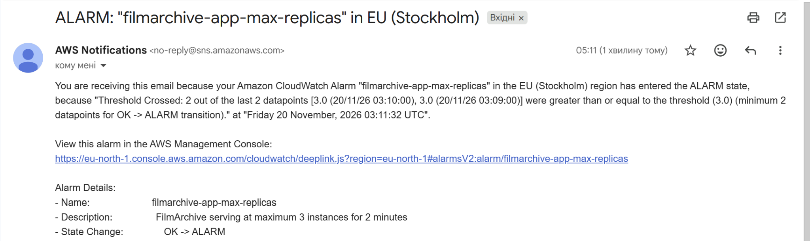
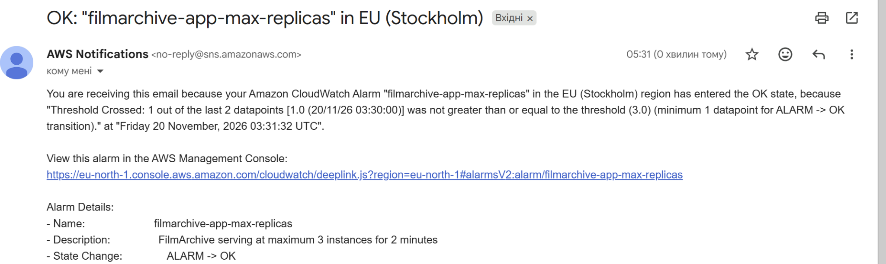
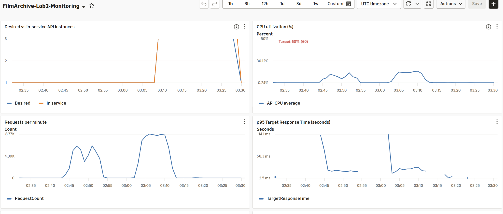
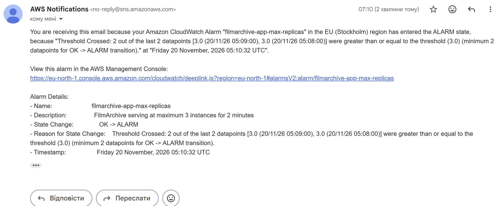
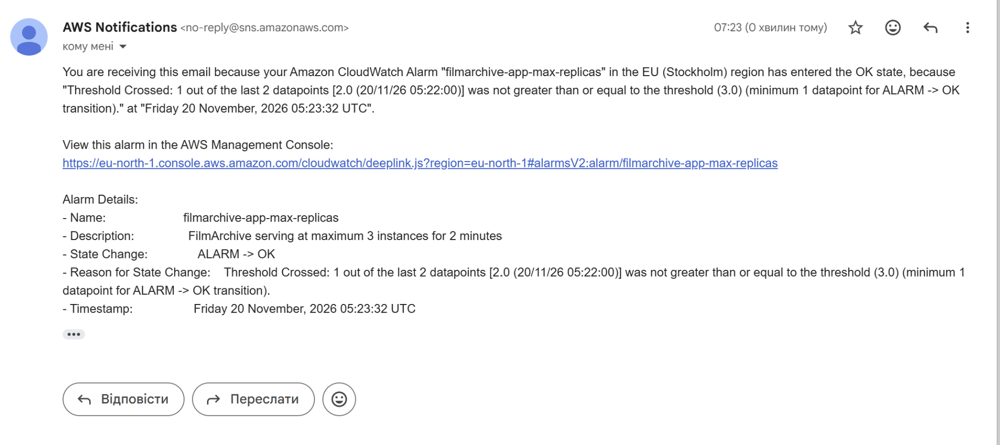

# Сповіщення про навантаження FilmArchive

**Завдання 4 — 2 бали.**  
**Terraform:** `terraform/monitoring.tf`.

## 1. Мета

Налаштувати автоматичні повідомлення на email у двох ситуаціях: коли навантаження перевищує задану умову і коли система повертається до нормального стану. Для цього використано CloudWatch Alarm та Amazon SNS.

## 2. Обрана умова тривоги

У Terraform створено `aws_cloudwatch_metric_alarm.app_maxed`:

| Параметр | Значення |
|---|---|
| Ім'я alarm | `filmarchive-app-max-replicas` |
| Простір метрик | `AWS/AutoScaling` |
| Метрика | `GroupInServiceInstances` |
| Група | `filmarchive-app-asg` |
| Поріг | 3 працюючі EC2 |
| Період | 60 секунд |
| Періодів для тривоги | 2 із 2 |
| Умова | `GreaterThanOrEqualToThreshold` |
| Відсутні дані | `notBreaching` |
| `alarm_actions` | SNS topic |
| `ok_actions` | Той самий SNS topic |

Методичка допускає сигнал про досягнення максимальної кількості екземплярів. Для API встановлено `max_size=3`, тому **два поспіль однохвилинні вимірювання з трьома активними серверами** переводять alarm у стан `ALARM`.

Коли кількість серверів опуститься нижче трьох і CloudWatch оцінить умову як нормальну, стан повернеться до `OK` і надійде другий лист.

## 3. Канал доставки

Terraform створює SNS topic `filmarchive-alerts-topic` і підписку з протоколом `email` за адресою `var.alert_email`.

**Обов'язковий крок після розгортання:** власник пошти отримує повідомлення *AWS Notification – Subscription Confirmation* і натискає `Confirm subscription`. До підтвердження підписка не доставлятиме листи про ALARM/OK.

За наявності кількох налаштованих alarm може надходити більше ніж два повідомлення: крім обов'язкового `app_maxed` існує додатковий alarm для `HTTPCode_Target_5XX_Count` на ALB.

## 4. Чому потрібні 2 хвилини, а не миттєвий сигнал

Короткий пік метрики може минути самостійно. Перевірка двох послідовних періодів зменшує кількість хибних або нестабільних сповіщень (flapping). Ціна стабільності — затримка між початком проблеми й отриманням листа.

Затримку формують:

1. Час, доки навантаження призвело до появи трьох EC2.
2. Збирання й публікація метрики CloudWatch.
3. Два 60-секундні інтервали оцінки alarm.
4. Передавання зміни стану через SNS.
5. Час доставки повідомлення поштовим провайдером.

Для навчального сигналу досягнення межі місткості затримка в кілька хвилин може бути прийнятною. Для критичного сервісу корисніше моніторити **p95 латентності** та помилки користувачів: CPU і кількість серверів не завжди показують проблеми із MySQL.

## 5. Фактична демонстрація в AWS — 20 листопада 2026 року

Повідомлення перевірені **на реальному AWS-розгортанні** в регіоні `eu-north-1`; email-підписку SNS попередньо підтверджено. Під навантаженням k6 група `filmarchive-app-asg` автоматично збільшила кількість працюючих EC2 з 1 до 3. Після завершення навантаження бажана кількість повернулася до 1; AWS вивів два зайвих екземпляри через `WaitingForELBConnectionDraining`, щоб завершити активні HTTP-з'єднання.

### 5.1. Реальні листи від AWS Notifications

| Подія | Час UTC (20.11.2026) | Час Києва (20.11.2026) | Доказ |
|---|---|---|---|
| Перехід `OK → ALARM` | **03:11:32** | **05:11:32** | Лист `ALARM: filmarchive-app-max-replicas` |
| Перехід `ALARM → OK` | **03:31:32** | **05:31:32** | Лист `OK: filmarchive-app-max-replicas` |
| Тривалість стану `ALARM` | **20 хвилин** | **20 хвилин** | Різниця часових позначок |

**Підтверджена причина `ALARM`:** CloudWatch мав 2 з 2 останніх однохвилинних значень метрики `GroupInServiceInstances`, що дорівнювали 3 (за періоди 03:09 і 03:10 UTC). Це відповідає правилу `GroupInServiceInstances >= 3` протягом двох послідовних хвилин. Перехід до `ALARM` зафіксовано о 03:11:32 UTC.

**Підтверджена причина `OK`:** вимірювання на 03:30 UTC показало значення 1 — нижче порогу 3. CloudWatch зареєстрував перехід `ALARM → OK` о 03:31:32 UTC, і спрацювала та сама email-підписка SNS.

> **Уточнення про час реакції.** Інтервал у 20 хвилин — це тривалість стану тривоги, **а не час реакції від початку сталої фази k6**. Точний початок сталої фази окремим машинним timestamp не зафіксовано, тому точну затримку до першого листа не стверджуємо. На CloudWatch видно, що пік навантаження й збільшення кількості EC2 передували першому листу; до них додаються час запуску EC2, оцінювання двох хвилин метрики та доставка SNS.

### 5.2. Підтверджувальні знімки

**Лист ALARM:**

**Лист OK:**

**CloudWatch Dashboard після тесту:**

Знімки листів обрізано до секції з фактичними timestamps і причинами переходу, щоб не розміщувати в публічному GitHub приватні реквізити акаунта та посилання відписки.

## 6. Оцінка реакції й практичний висновок

Сигналізатор спрацював **і в ALARM, і в OK**. Умова досягнення максимуму 3 EC2 корисна тим, що повідомляє про вичерпання запасу горизонтального масштабування. Вона не гарантує попередження про всі проблеми із затримкою відповідей: для реального продукту додатково варто контролювати p95, частку HTTP 5xx і доступність сервісу.

Значення `period=60`, `evaluation_periods=2` захищають від коротких сплесків, але створюють затримку. Час запуску нового EC2, перевірки ALB і захист від нестабільного масштабування також впливають на загальний час реакції. Для навчального тесту це прийнятна демонстрація; для сервісу з суворим SLA потрібно добирати пороги за бізнес-вимогами та тестувати доставку окремо.

<!-- FILMARCHIVE_CPU60_20261120 -->

## Додаткова перевірка сповіщень під час CPU-тесту (20.11.2026)

Під час комбінованого випробування k6 і CPU-стресу CloudWatch повторно підтвердив доставку **двох реальних листів** через Amazon SNS. Умова тривоги — 3 активні API EC2 протягом двох послідовних хвилин (alarm `filmarchive-app-max-replicas`).

| Подія | Час UTC | Час Києва |
|---|---|---|
| `OK → ALARM` | **05:10:32** | **07:10:32** |
| `ALARM → OK` | **05:23:32** | **07:23:32** |
| Тривалість стану ALARM | **13 хвилин** | **13 хвилин** |

Перехід до `OK` зафіксовано, коли кількість працюючих API EC2 стала меншою за 3. Це **не означає**, що кількість уже дорівнювала мінімальному значенню 1: для цієї тривоги достатньо падіння нижче 3.

