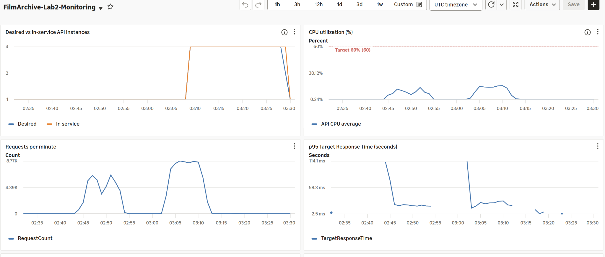
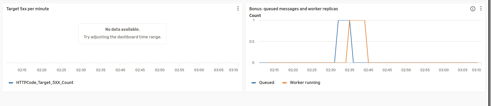
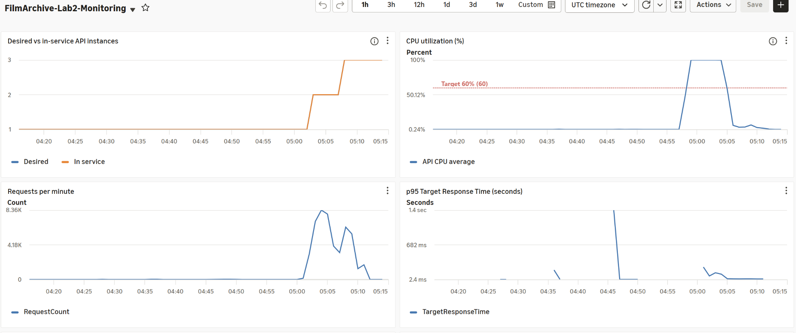
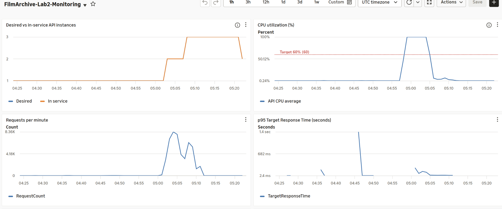

# Автоматичне масштабування та моніторинг FilmArchive

**Завдання 1 — 2 бали; завдання 3 — 2 бали.**  
**Файли Terraform:** `terraform/main.tf`, `terraform/autoscaling.tf`, `terraform/request-scaling.tf`, `terraform/monitoring.tf`.

## 1. Мета

Забезпечити можливість автоматично збільшувати кількість серверів API під навантаженням, а потім зменшувати її, коли трафік спадає. Крім масштабування, потрібно спостерігати за завантаженням процесора, запитами, затримкою відповідей та помилками через CloudWatch Dashboard.

## 2. Архітектура

```text
Користувачі / Grafana k6
          |
          v
 Application Load Balancer
          |
          v
Auto Scaling Group (1–3 EC2, Docker, Node.js)
          |
          +----> RDS MySQL у приватних підмережах
          +----> Redis на окремому EC2
          +----> SQS (асинхронні запити)
```

API-екземпляри створюються з `aws_launch_template.app`; автоматичним додаванням і видаленням керує `aws_autoscaling_group.app`. Балансувальник направляє запити тільки на зареєстровані цілі, які проходять перевірки працездатності.

## 3. Параметри політики

| Параметр | Значення | Пояснення |
|---|---|---|
| `min_size` | 1 | Мінімум для базового режиму, вночі |
| `max_size` | 3 | Верхня межа менша за дозволені методичкою 4 |
| `desired_capacity` | 1 | Базове бажане значення при ініціалізації |
| Метрика №1 | `ASGAverageCPUUtilization` | CPU-орієнтоване масштабування й автоматичне зменшення кількості EC2 |
| Метрика №2 | `ALBRequestCountPerTarget` | Автоматичне збільшення кількості EC2 за кількістю запитів через ALB |
| Ціль за запитами | 1000 запитів на ціль за хвилину | Захищає I/O-bound API, коли CPU нижче 60% |
| Scale-in для політики запитів | `disable_scale_in = true` | Політика запитів збільшує кількість EC2, а CPU-політика відповідає за їхнє зменшення |
| Цільове значення | 60% | Залишає орієнтовно 40% резерву для піків |
| `estimated_instance_warmup` | 180 секунд | Час врахування нового екземпляра після масштабування |
| `health_check_grace_period` | 600 секунд | Час для встановлення Docker, завантаження образу та старту API |
| Верхня межа кількості worker | 1 | Окрема група 0–1 для асинхронних повідомлень |

**Чому саме 60%?** За CPU 60% механізм target tracking намагається підтримувати помірний запас потужності та додавати сервери до перевантаження. Проте FilmArchive частково I/O-bound: запити можуть чекати MySQL, а CPU при цьому не обов'язково високий. На реальному тесті CPU не досягнув 60%, попри високу кількість HTTP-запитів. Тому до CPU-політики було додано **другу target-tracking policy `ALBRequestCountPerTarget`** із ціллю 1000 запитів на сервер за хвилину. Під час випробування вона забезпечила scale-out до 3 EC2. Спочатку обидві політики мали дозвіл на scale-in; після завершення навантаження це затримало зменшення групи, тому в політиці запитів встановлено `disable_scale_in = true`, залишивши scale-in CPU-політиці. Після цієї зміни було підтверджено автоматичне повернення до одного EC2.

### 3.1. Cooldown і прогрів

*Cooldown* — період стабілізації після дії масштабування, який захищає систему від надто частих рішень. У target tracking значну роль відіграють `instance_warmup` та вбудована консервативна логіка зменшення групи. Якщо умовно встановити cooldown у нуль, короткі стрибки метрик можуть спричинити часте створення й вилучення інстансів (thrashing) ще до того, як нові сервери стануть готовими.

**Чому scale-out не миттєвий?** CloudWatch збирає метрики з певною періодичністю; далі AWS обчислює рішення, запускає EC2, виконується user data, Docker витягує образ, застосунок стартує, ALB очікує успішних health checks.

**Чому scale-in повільніший?** Різке вилучення серверів могло б спричинити повторні стрибки навантаження і втрату активних запитів. ALB використовує deregistration/draining, а Node.js обробляє `SIGTERM` у `src/server.js`, щоб припинити прийом нових з'єднань і завершити активні запити в межах таймауту.

## 4. П'ять обов'язкових графіків CloudWatch

Terraform створює Dashboard `FilmArchive-Lab2-Monitoring`.

| № | Графік | Простір і метрика | Агрегування |
|---|---|---|---|
| 1 | Бажана і фактична кількість API-екземплярів | `AWS/AutoScaling`: `GroupDesiredCapacity`, `GroupInServiceInstances` | 1 хв, Average |
| 2 | CPU API | `AWS/EC2`: `CPUUtilization` для Auto Scaling Group | 1 хв, Average, орієнтир 60% |
| 3 | HTTP-запити за хвилину | `AWS/ApplicationELB`: `RequestCount` | 1 хв, Sum |
| 4 | Латентність p95 | `AWS/ApplicationELB`: `TargetResponseTime` | 1 хв, p95, **секунди** |
| 5 | HTTP 5xx від backend | `AWS/ApplicationELB`: `HTTPCode_Target_5XX_Count` | 1 хв, Sum |

Шостий, бонусний графік порівнює `AWS/SQS: ApproximateNumberOfMessagesVisible` та `AWS/AutoScaling: GroupInServiceInstances` групи worker.

Важливо відрізняти метрики ASG від метрик ECS: у проєкті використані **EC2 Auto Scaling Groups**, а не ECS Tasks.

## 5. План демонстрації

1. Перевірити, що API доступний за DNS ALB та всі цілі в target group здорові.
2. До тесту зафіксувати бажану й фактичну кількість екземплярів та час початку.
3. Запустити k6 на 10 хвилин (3 хв наростання, 5 хв сталі VUs, 2 хв спад).
4. Підібрати N так, щоб система реально додала EC2 під час сталої фази. N=10 для локального тесту не є доказом хмарного масштабування.
5. Зафіксувати **перетин порога метрики, яка фактично запускає масштабування**: у цьому проєкті це навантаження за HTTP-запитами; CPU 60% не перетнуто, що прямо пояснено у звіті. Також зафіксувати нові EC2, кількість запитів, p95 і 5xx.
6. Після тесту перевірити scale-in та повернення до актуального мінімуму (1 вночі або 2 вдень).

## 6. Реальна перевірка 20 листопада 2026 року

В AWS успішно застосовано Terraform для 49 нових ресурсів, після чого додано окрему політику `filmarchive-requests-1000`. API через ALB відповідав `HTTP 200 OK`, target group показала `healthy` і локальний PowerShell smoke-тест підтвердив реєстрацію, профіль користувача, Redis та ідемпотентність (асинхронний worker мав окрему помилку, яка описана в `docs/QUEUE.md`).

### 6.1. Фактична реакція на навантаження

- Початковий стан: `MinSize=1`, `DesiredCapacity=1`, один працездатний EC2.
- На другому хмарному прогоні k6, після додавання масштабування за `ALBRequestCountPerTarget`, CloudWatch показав приблизно **8,8 тис. запитів на хвилину** на піку. Це орієнтовне значення, зчитане з графіка, не точний експорт CloudWatch.
- Auto Scaling зафіксував успішний запуск **двох нових EC2** близько `03:08:36 UTC`. У `describe-auto-scaling-groups` всі три сервери мали стан `InService`.
- Налаштована межа: максимум `3` екземпляри (дотримано обмеження методички — не більше 4).
- CPU залишався нижче 60%; запуск додаткових EC2 спричинило **правило запитів**, а не CPU. Це пояснюється характером I/O-bound API, який значний час очікує на MySQL.
- Після завершення k6 й корекції `disable_scale_in=true` для HTTP-політики, Auto Scaling встановив `DesiredCapacity=1` та розпочав автоматичне завершення двох зайвих EC2. Журнал показав `WaitingForELBConnectionDraining`; це не аварія, а завершення активних з'єднань перед вилученням EC2.
- Фінальний скриншот CloudWatch відображає весь цикл **1 → 3 → 1**.

### 6.2. Графіки та пояснення



1. **Desired / InService**: під час scale-out з'явилися додаткові екземпляри; після припинення тесту бажана та фактична кількість зменшилися до одного.
2. **CPU**: помітні підвищення під час прогонів, але поріг 60% не досягнутий. Це демонструє, чому сам CPU недостатній для I/O-bound сервісу.
3. **RequestCount**: кількість запитів різко зросла під час k6 і повернулася майже до нуля після тесту. Пікова висота на графіку — близько 8,8 тис./хв.
4. **p95 TargetResponseTime**: зростання і падіння затримки backend, одиниця метрики AWS — секунди; UI може показувати мілісекунди. Відрізняється від наскрізного p95 k6.
5. **HTTPCode_Target_5XX_Count**: панель налаштована, але `No data available` для вибраного часового інтервалу. Це означає відсутність точок у вибраній метриці, а не доказ нульової кількості будь-яких HTTP-помилок.

**Бонусний графік** черги SQS і worker (демонструє запуск обробника за появи повідомлення):



### 6.3. Перевірені часові орієнтири

| Подія | Час UTC | Джерело |
|---|---|---|
| Старт двох додаткових EC2 | `03:08:36` | `aws autoscaling describe-scaling-activities` |
| `OK → ALARM` через 3 in-service EC2 | `03:11:32` | SNS email `ALARM` |
| `ALARM → OK` через повернення до менш ніж 3 EC2 | `03:31:32` | SNS email `OK` |
| Тривалість стану `ALARM` | **20 хв** | Різниця часових позначок |

Початок сталої фази k6 не записаний як точний абсолютний timestamp, тому час «від початку плато до запуску EC2» не вигадуємо. Досвід показав затримку між сплеском навантаження та готовністю EC2 через періодичність метрик, warmup `180s`, запуск VM, Docker і перевірки здоров'я ALB. Scale-in додатково враховує захист від коливань і ELB connection draining.

## 7. Висновок і наступні дії

**Автоматичне масштабування в AWS продемонстровано:** один працездатний API EC2 → три під навантаженням → один після спаду; CloudWatch Dashboard містить п'ять обов'язкових графіків. Також отримано SNS-листи `ALARM` та `OK` (див. `docs/ALERTS.md`).

Для остаточної здачі потрібно звірити результати експорту другого прогону `loadtest/results-aws-scale02.json` з `docs/LOADTEST.md`, перевірити всі документи в тому самому GitHub-репозиторії та після захисту безпечно прибрати платні ресурси через Terraform із **правильним state** (окрема папка `C:\int\filmarchive-lab2-aws-runtime`).

<!-- FILMARCHIVE_CPU60_20261120 -->

## Фінальний комбінований тест: перетин 60% CPU (20.11.2026)

Додатково до перевіреного масштабування за запитами проведено **контрольований CPU-стрес-тест паралельно з 10-хвилинним k6**. Навантаження CPU створено окремою обмеженою в часі командою AWS Systems Manager (SSM); це не звичайне продукційне навантаження HTTP.

- **Фактичний пік CPU: 100%** — поріг **60%** перетнуто, що видно на графіку CloudWatch.
- Кількість робочих API-екземплярів зросла **з 1 до 2, потім до 3**; на пізнішому графіку зафіксовано початок зменшення **з 3 до 2**. Повний цикл **1 → 3 → 1** також був підтверджений попереднім окремим тестом і його скриншотом `scale-cycle.png`.
- На піку графік `RequestCount` показував приблизно **8,36 тис. HTTP-запитів за хвилину** (значення з осі графіка).
- Після спаду навантаження CloudWatch зафіксував повернення сигналу про максимальну кількість інстансів у стан `OK`.





Результати k6 та порівняння затримок наведено у [`LOADTEST.md`](LOADTEST.md). Цей графік надає додатковий доказ спрацювання **CPU-порогу**, тоді як попередній сценарій окремо підтвердив масштабування **за інтенсивністю HTTP-запитів**.
