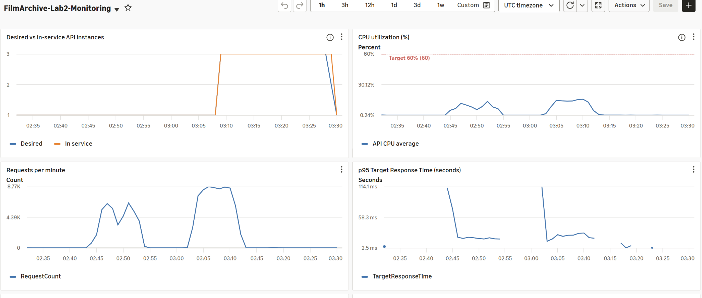
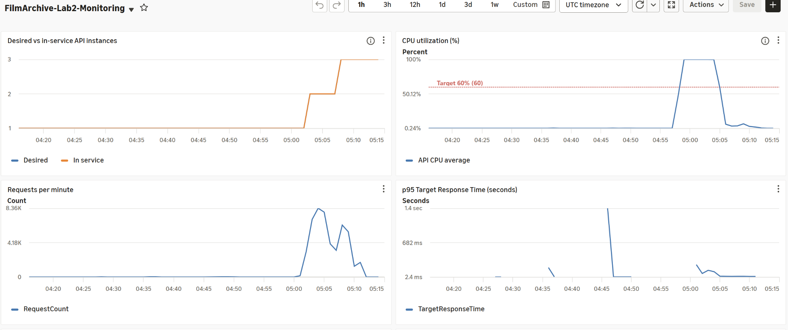

# Навантажувальне тестування FilmArchive

**Завдання 2 — 2 бали.**  
**Сценарій:** `loadtest/filmarchive.js`.  
**Інструмент:** Grafana k6 v2.4.0.

## 1. Мета і профіль користувача

Потрібно відтворити поведінку користувачів, які рідко додають записи, але часто читають каталог. Після авторизації **один віртуальний користувач в кожній ітерації** виконує:

1. `POST /api/media` — створення нового запису (1 запис).
2. `GET /api/media` — список записів (3 рази).
3. `GET /api/media/:id` — щойно створений запис (3 рази).
4. `GET /api/media/me` — дані власника (3 рази).

Разом: **один запис і дев'ять читань**. Окремі запити реєстрації та входу виконуються на початку для кожного VU. Тип `LoadTest` дозволяє не звертатися до зовнішніх каталогів фільмів, щоб вимірювати передусім власний API та MySQL.

## 2. Фази сценарію

| Фаза | Тривалість | Кількість VUs |
|---|---|---|
| Поступове наростання | 3 хв | 0 → N |
| Стала | 5 хв | N |
| Поступове зменшення | 2 хв | N → 0 |
| **Загалом** | **10 хв** | |

Для **локальних** тестів встановлено `VUS=10`. У хмарному експерименті N потрібно підбирати окремо так, щоб на графіках було видно реальне масштабування.

## 3. Команда запуску (локально)

```powershell
cd C:\int\film_archive
k6 run `
  -e BASE_URL=http://localhost:3001 `
  -e VUS=10 `
  -e RUN_ID=local01 `
  --summary-trend-stats="avg,min,med,p(90),p(95),p(99),max" `
  --summary-export=loadtest/results-local01.json `
  .\loadtest\filmarchive.js
```

`RUN_ID` має бути унікальним, щоб повторне тестування не використовувало ті самі тестові логіни. Файл `results-*.json` зберігається локально; його не потрібно автоматично комітити в Git.

Якщо команда `k6` відсутня в новому PowerShell, потрібно додати каталог `C:\Program Files\k6` до користувацького PATH.

## 4. Фактичні результати двох локальних тестів

Виконано два **10-хвилинні локальні** прогони з однаковою кількістю VUs та фазами. Перемикання кешу виконано через `CACHE_ENABLED` і перевідтворення контейнерів API та worker. У першому прогоні кеш був увімкнений, у другому — вимкнений.

| Показник k6 | З кешем | Без кешу |
|---|---:|---:|
| `VUS`, максимум | 10 | 10 |
| Тривалість | 10 хв | 10 хв |
| HTTP-запитів (`http_reqs`) | 128 000 | 149 920 |
| Частка помилок (`http_req_failed`) | 0,00% | 0,00% |
| Перевірок (`checks_total`) | 127 990 | 149 910 |
| Успішних перевірок | 100% | 100% |
| Запитів/с (`http_reqs`, rate) | 213,29 | 249,84 |
| Середня затримка | 20,42 мс | 15,22 мс |
| p50 (медіана) | 11,97 мс | 10,17 мс |
| p95 | 62,99 мс | 40,35 мс |
| p99 | 102,00 мс | 61,54 мс |
| Максимальна затримка | 1,88 с | 1,73 с |
| Ітерацій (`iterations`) | 12 798 | 14 990 |
| Успішних записів (`media_writes`) | 12 798 | 14 990 |
| Успішних читань | 115 182 | 134 910 |
| Обсяг отриманих даних | 7,9 ГБ | 11 ГБ |

**Первинні результати:** `loadtest/results-local01.json` та `loadtest/results-no-cache.json` — локальні експорти k6. Наведені числа також підтверджені текстовими результатами команд у PowerShell.

## 5. Тлумачення метрик

- **p50** означає, що приблизно 50% запитів завершилися не повільніше зазначеного часу.
- **p95** — приблизно 95% запитів уклалися у цей час; 5% були повільнішими.
- **p99** показує затримку на межі найповільнішого одного відсотка запитів.
- **Requests/s** — середня пропускна здатність за час прогону, а не кількість одночасних користувачів.
- **Error rate** — частка невдалих HTTP-запитів. Для обох прогонів k6 зафіксував 0%.

## 6. Аналіз отриманих результатів

**Спостереження:** у другому прогоні, коли кеш був вимкнений, p95 зменшився з 62,99 до 40,35 мс, а середня швидкість зросла з 213,29 до 249,84 запитів/с.

**Чого ці числа не доводять:** цей результат не означає, що кешування загалом погіршує продуктивність. Прогони виконані послідовно, MySQL накопичив нові записи, могли змінитися стан кешу ОС/БД і прогрів контейнерів. Крім того, після кожного POST застосунок інвалідує кеш користувача, тому перше зі спискових читань часто спричиняє cache miss. Надійний висновок про користь кешу потребує однакового набору даних, кількох повторень та вимірювання MySQL SELECT/CPU/IOPS.

## 7. Реальне тестування в AWS (20 листопада 2026 року)

Застосунок розгорнуто в регіоні `eu-north-1`: Application Load Balancer → група Auto Scaling із контейнеризованим Node.js API → RDS MySQL, Redis та SQS. Перевірка `GET /health` через балансувальник повернула `HTTP 200`, а ALB Target Group підтвердила стан `healthy`.

### 7.1. Перший хмарний прогін: `aws-lab2-final`

Команда запуску:

```powershell
cd C:\int\film_archive
& "C:\Program Files\k6\k6.exe" run `
  -e BASE_URL=http://filmarchive-alb-635411755.eu-north-1.elb.amazonaws.com `
  -e VUS=30 `
  -e RUN_ID=aws-lab2-final `
  --summary-trend-stats="avg,min,med,p(90),p(95),p(99),max" `
  --summary-export=loadtest/results-aws-final.json `
  .\loadtest\filmarchive.js
```

Тест відпрацював **10 хвилин** (3+5+2), максимум 30 VUs. Офіційний підсумок k6 у PowerShell:

| Показник | Фактичне значення |
|---|---:|
| Усього HTTP-запитів (`http_reqs`) | **43 550** |
| Середня швидкість (`http_reqs.rate`) | **72,44 запиту/с** |
| Частка невдалих HTTP-запитів | **2 / 43 550 ≈ 0,0046%** |
| Перевірок (`checks_total`) | 43 520 |
| Успішних перевірок | 43 518 із 43 520 |
| Медіана / **p50** | **200,96 мс** |
| **p95** | **841,40 мс** |
| **p99** | **1 450 мс** |
| Середня затримка | 296,85 мс |
| Максимальна затримка | 6,76 с |
| Успішних POST (`media_writes`) | 4 349 |
| Успішних GET (`read_success`, не hit ratio Redis) | 39 139 із 39 141 |

Примітка: k6 показував `http_req_failed=0.00%` через округлення; реальна кількість — **2 невдалі відповіді**. Це не тотожно двом відповідям HTTP 5xx: статуси цих двох запитів не збережено в наведеному текстовому підсумку. Метрика `read_success` у сценарії означає частку GET зі статусом 200, а **не** частку влучань у кеш Redis.

### 7.2. Другий хмарний прогін: `aws-scale02`

Після першого випробування до Terraform додано масштабування за `ALBRequestCountPerTarget` із ціллю **1 000 запитів на сервер за хвилину**, оскільки CPU у першому тесті не досягав 60%.

```powershell
cd C:\int\film_archive
& "C:\Program Files\k6\k6.exe" run `
  -e BASE_URL=http://filmarchive-alb-635411755.eu-north-1.elb.amazonaws.com `
  -e VUS=30 `
  -e RUN_ID=aws-scale02 `
  --summary-export=loadtest/results-aws-scale02.json `
  .\loadtest\filmarchive.js
```

**Підтверджені факти з CloudWatch, AWS CLI та SNS:**

- Приблизний пік за графіком CloudWatch: **8,8 тис. запитів/хв**; це оцінка з графіка, не точне значення експорту.
- Автоматичне **scale-out з 1 до 3 EC2**; два нових EC2 запущено близько **03:08:36 UTC**.
- Після завершення тесту та вимкнення scale-in саме для політики запитів AWS автоматично зменшив кількість екземплярів **з 3 до 1**. Scale-in залишився керованим CPU-політикою.
- SNS alarm `filmarchive-app-max-replicas`: перехід `OK → ALARM` о **03:11:32 UTC**, відновлення `ALARM → OK` о **03:31:32 UTC**.
- Випробування продемонструвало горизонтальне масштабування за реальною метрикою запитів; **CPU-поріг 60% під час цих k6-прогонів не було перетнуто**.

**Статистика самого другого прогону** має підтягуватися з локального файлу `loadtest/results-aws-scale02.json`; текстового підсумку цього прогону в наданих матеріалах немає. Без нього значення p50/p95/p99 другого прогону не можна достовірно записати.

<!-- SECOND_AWS_METRICS_START -->
| Показник другого прогону | Фактичне значення |
|---|---:|
| HTTP-запитів | 0 |
| Пропускна здатність | 0 запитів/с |
| Невдалих HTTP-запитів | 0 із 0 (0%) |
| p50 | 0 мс |
| p95 | 0 мс |
| p99 | 0 мс |
<!-- SECOND_AWS_METRICS_END -->

Для автоматичного заповнення використовується окремий скрипт `Install-Lab2Reports.ps1` із пакета документації: якщо у папці `loadtest/` присутній JSON, він сам підставить точні цифри.

### 7.3. Скриншоти моніторингу



П'ять необхідних графіків налаштовані в Terraform: бажана й фактична кількість екземплярів, CPU, запити за хвилину, p95, HTTP 5xx. Для `HTTPCode_Target_5XX_Count` у вибраному інтервалі CloudWatch показує `No data available` — це відсутність точок метрики, **а не доказ відсутності будь-яких помилок**.

Детальна інтерпретація графіків та часу між сплеском трафіку й появою EC2 наведена у `docs/AUTOSCALING.md`. Скриншоти двох SNS-листів та аналіз затримки — у `docs/ALERTS.md`.

## 8. Висновок

Сценарій відповідає методичці: 1 POST і 9 GET за ітерацію; 3 хв поступового наростання, 5 хв плато, 2 хв спаду. Два локальні прогони виконано з 0% невдалих HTTP-запитів, а перший повний хмарний тест обробив 43 550 запитів із двома невдалими відповідями. Другий хмарний прогін підтвердив **автоматичне масштабування 1 → 3 → 1**. За реальним характером трафіку основним тригером scale-out стали HTTP-запити, а не CPU.

<!-- FILMARCHIVE_CPU60_20261120 -->

## Додатковий фінальний тест k6 + контрольоване CPU-навантаження (20.11.2026)

Проведено 10-хвилинний хмарний прогін `RUN_ID=aws-cpu60`, `VUS=30`, `PAUSE=0.15` (3 хв ramp-up, 5 хв plateau, 2 хв ramp-down). Одночасно на одному API EC2 за допомогою SSM створено **окреме контрольоване CPU-навантаження**, аби перевірити реакцію Auto Scaling на поріг 60%.

| Показник | Реальний результат |
|---|---:|
| Тривалість k6 | 10 хв |
| Максимальна кількість VU | 30 |
| HTTP-запитів | **48 580** |
| Середня інтенсивність | **80,90 запитів/с** |
| Частка HTTP-помилок | **0,00% (0 із 48 580)** |
| Успішні checks | **48 550 із 48 550 (100%)** |
| Успішні POST (`media_writes`) | **4 852** |
| Успішні GET (`read_success`) | **43 668** |
| Середня затримка HTTP | **266,07 мс** |
| p50 | **150,97 мс** |
| p95 | **636,84 мс** |
| p99 | **1,92 с** |
| Максимальна затримка | **41,15 с** |
| Максимум CPU на графіку | **100%** |
| Реально підтверджене збільшення API EC2 | **1 → 2 → 3** |

Первинний експорт k6: `loadtest/results-aws-cpu60.json` (створений командою `--summary-export`). Показник CPU отриманий зі справжнього графіка AWS CloudWatch; його **не можна інтерпретувати як CPU-споживання від одного лише k6**, оскільки паралельно працював SSM CPU-стрес-тест. Обидва експерименти разом демонструють доступність API під навантаженням та реальне перетинання цільового порогу CPU.


