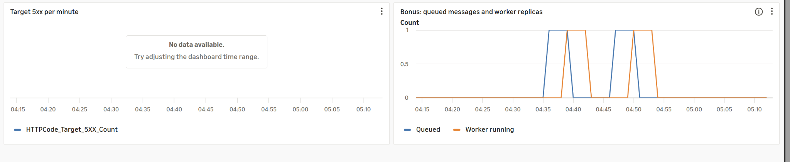

# Асинхронна обробка через чергу

**Бонусне завдання 6 — 2 бали.**  
**Код:** `src/controllers/mediaController.js`, `src/lib/queue.js`, `src/worker.js`, `src/migrate.js`.  
**Інфраструктура:** `terraform/autoscaling.tf` (SQS та worker ASG).

## 1. Навіщо черга

Звичайний синхронний `POST /api/media` очікує запис у MySQL і повертає `201 Created`. Для асинхронного варіанта API приймає задачу, ставить повідомлення в чергу і відразу повертає `202 Accepted`. Створення запису відбувається пізніше, в окремому worker.

Це розділяє час приймання запиту та час тривалої обробки, дозволяє контролювати чергу і незалежно масштабувати обробників. **HTTP 202 не означає, що фільм уже записано в базу.**

## 2. API-контракт

1. Авторизований клієнт надсилає `POST /api/media/async` з JWT та JSON-полями фільму.
2. Сервер перевіряє дані, створює `job_id`, зберігає запис зі станом `pending` у таблиці `media_jobs` та надсилає повідомлення у чергу.
3. API відповідає `202 Accepted` і повертає `job_id`, `status`, `status_url`.
4. Клієнт періодично робить `GET /api/media/jobs/:jobId` із тим самим JWT.
5. Після успішного виконання worker статус змінюється на `done` і з'являється `media_id`.

Приклад структури відповіді (схема, не реальний результат конкретного запиту):

```json
{
  "job_id": "<uuid>",
  "status": "pending",
  "status_url": "/api/media/jobs/<uuid>"
}
```

У застосунку синхронний `POST /api/media` зберігається для тесту співвідношення записів і читань, а async-маршрут демонструє бонусне завдання.

## 3. Локальна архітектура

```text
HTTP POST /api/media/async
           |
           v
       Node.js API
           |
           v
      Redis queue
           |
           v
  worker (окремий контейнер)
           |
           v
   транзакція MySQL
           |
           v
       media_jobs.done
```

Локальна черга використовує Redis-списки `filmarchive:jobs` та `filmarchive:processing`. Перед виконанням повідомлення переміщується зі списку очікування у список обробки, після успіху вилучається. При перезапуску worker виконує відновлення незавершених повідомлень (`recoverLocal`).

## 4. Хмарна архітектура

В AWS замість локального Redis-списку використовується **SQS Standard**:

- `filmarchive-media-jobs` — робоча черга.
- `filmarchive-media-jobs-dlq` — dead-letter queue для повторно невдалих повідомлень.
- Visibility timeout — 90 секунд.
- Long polling — 10 секунд.
- Переміщення в DLQ після 5 невдалих отримань.
- Worker EC2 Auto Scaling Group — min 0, max 1.
- CloudWatch контролює `ApproximateNumberOfMessagesVisible`; якщо повідомлення з'являються — scaling policy збільшує кількість worker, якщо черга довго порожня — зменшує до нуля.

Під час scale-in не можна оцінювати лише кількість *видимих* повідомлень: повідомлення, яке зараз обробляється, може бути тимчасово невидимим. Для надійнішої production-політики варто враховувати `ApproximateNumberOfMessagesNotVisible` і захист від завершення зайнятого worker.

Перевага масштабування до нуля — економія в періоди простою. Недолік — **холодний старт**: перш ніж worker прочитає повідомлення, EC2 повинен завантажитися, підготувати Docker і отримати образ; це може займати хвилини.

## 5. Повторна доставка та захист від дублювання

SQS Standard надає семантику **at-least-once**: одне повідомлення інколи може бути видане повторно. Це нормально для черг, тому сам worker повинен бути ідемпотентним.

У `src/worker.js` перед вставкою фільму worker відкриває транзакцію MySQL і виконує `SELECT ... FOR UPDATE` для рядка `media_jobs`. Якщо стан уже `done`, повторний виклик не створює нового медіазапису. Інакше worker вставляє фільм і встановлює `done` в тій самій транзакції. Якщо процес аварійно завершується **після commit, але до ACK**, повторна доставка не повинна призвести до другого INSERT.

**At-most-once** означає доставку не більше одного разу, але не гарантує успішної обробки; **at-least-once** дозволяє повтори й потребує захисту від дублювання.

## 6. Локальні перевірки

У виконаному `smoke.ps1` п'ятий етап `Test async creation and poll job` завершився успішно: `Async OK`, було повернуто `id` нового запису. Це підтверджує роботу локального асинхронного шляху.

Додатковий k6-сценарій `loadtest/queue.js` може тестувати приймання async-завдань і отримання їхнього статусу:

```powershell
k6 run -e BASE_URL=http://localhost:3001 -e RUN_ID=queue01 .\loadtest\queue.js
```

**Увага:** цей додатковий k6-сценарій ще не має підтвердженого результату у наданих логах; не слід записувати його як уже виконаний.

## 7. Результати AWS і критерії перевірки

- Справжню відповідь HTTP 202 з `job_id` і подальший статус `done`.
- Один створений фільм для одного job при можливому повторному отриманні повідомлення.
- Графік довжини SQS-черги.
- Збільшення worker ASG 0 → 1 і зменшення 1 → 0 після спаду.
- Порівняння p95 синхронного й асинхронного приймання запитів за однакових умов.

| Показник | Стан |
|---|---|
| Локальний async шлях | Підтверджений smoke-тестом |
| Реальна SQS-черга в AWS | Створена Terraform; отримано повідомлення у черзі |
| Масштабування worker за довжиною черги | CloudWatch ALARM; worker ASG Desired=1; EC2 InService |
| Графік worker + SQS | [screenshots/queue-worker.png](screenshots/queue-worker.png) |
| Порівняння затримки синхронного та async API | Не виміряно |

## 8. Висновок

Локальний async-шлях працює. В AWS підтверджені SQS, створення повідомлення, сигнал CloudWatch та автоматичний запуск worker за довжиною черги. Завершення запису в MySQL перевіряється окремим HTTP GET статусу завдання: очікується state=done.

## Підтверджений результат перевірки в AWS

Під час перевірки `scripts/smoke.ps1` асинхронне створення запису успішно завершилося.

- Job ID: `d74d0aad-fac4-4b01-9e82-c74d7b36d989`
- Результат: `Async OK, id=11338`
- Підсумок тесту: `Local tests passed.`
- Auto Scaling worker: `Desired = 0` до навантаження, `Desired = 1`, `InService` після появи повідомлення.
- SQS: 0 повідомлень після обробки.
- Dead-letter queue: 0 повідомлень.

Підтверджено обробку повідомлення з AWS SQS і створення запису в MySQL.

<!-- FILMARCHIVE_CPU60_20261120 -->

## Додатковий доказ автоматичного запуску worker

На графіку Amazon CloudWatch показано появу повідомлень у реальній черзі Amazon SQS та реакцію worker Auto Scaling Group: **0 → 1 робочий EC2**, з подальшим поверненням до нуля. Функціональна перевірка `scripts/smoke.ps1` додатково підтвердила успішне виконання асинхронного завдання `d74d0aad-fac4-4b01-9e82-c74d7b36d989`: **`Async OK, id=11338`**. Після обробки основна SQS-черга та dead-letter queue мали по 0 повідомлень.


